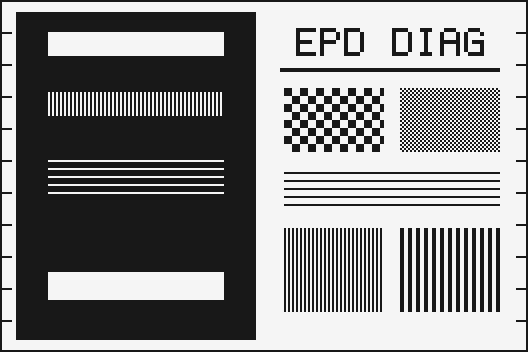
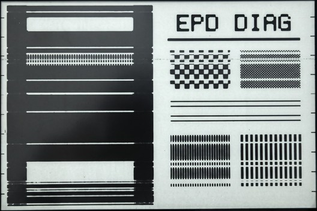

# displio-rebirth

[](https://github.com/Ldo-fr/displio-rebirth/releases)
[](https://github.com/Ldo-fr/displio-rebirth/actions/workflows/build.yml)
[](https://github.com/Ldo-fr/displio-rebirth-ha)
[](LICENSE)

Give a second life to the **Displio V1.0** Wi-Fi E-Ink desk display (Draugiem Group, 2015) whose original cloud service has been shut down — replace its proprietary firmware with a 100% open-source, self-hosted, local-first firmware, flashed entirely over USB with **no soldering, no disassembly, and no ST-Link**.

> [!NOTE]
> This is an independent, **non-profit**, volunteer-driven open-source project created so that a great piece of hardware doesn't end up forgotten at the bottom of a drawer or in the trash. It is **not affiliated with, endorsed by, or associated with** Displio or Draugiem Group in any way.

Original Kickstarter campaign: https://www.kickstarter.com/projects/914874115/displio-wifi-display-that-tracks-whats-important-t

---

## Features

- **100% USB flashing & unbrickable design**: uses the factory USB HID bootloader (`0483:a197`). The bootloader region (`0x08000000`–`0x08003FFF`) is hardware-protected and never modified.
- **2.7" E-Ink display (`264 × 176`, 1-bpp)**: bare-metal Pervasive Displays G2 COG driver with full and fast refresh modes.
- **Onboard sensors**:
  - `Si7021` ambient temperature (°C) and relative humidity (%)
  - `MMA8452Q` 3-axis accelerometer and portrait/landscape orientation
  - Battery voltage ADC (`PC13` → `PA0`) & `VDDA` via internal `Vrefint`
  - Front button (`PA2`) and USB power detection (`PA9`)
- **Piezo buzzer**: configurable frequency and duration (`PB0` / `TIM3_CH3`).
- **2.4 GHz Wi-Fi (`TI CC3000`)**: bare-metal SPI2 driver with persistent credentials stored in STM32 Flash (`0x0801F800`), auto-connect at boot, and automatic reconnect.
- **Local HTTP/1.1 REST API** (no cloud required):
  - `GET /status` — live JSON telemetry of all sensors, power, and network info
  - `POST /display[?full=1]` — push a 5,808-byte monochrome image to the E-Ink screen
  - `POST /beep[?freq=&ms=]` — trigger the piezo buzzer
  - `GET /` — healthcheck
- **Home Assistant ready**: pairs directly with the companion HACS integration — **[Ldo-fr/displio-rebirth-ha](https://github.com/Ldo-fr/displio-rebirth-ha)**.

---

## Project Status

- [x] **Phase 1**: USB HID bootloader protocol reverse-engineered — [docs/protocol.md](docs/protocol.md)
- [x] **Phase 2**: Hardware discovery (`STM32F103xB`, 72 MHz, 128 KiB Flash, 20 KiB RAM) & flasher tool — [docs/hardware.md](docs/hardware.md)
- [x] **Phase 3**: Custom bare-metal STM32 firmware (USB HID `DISPLIO REBIRTH`, 2.7" E-Ink, piezo buzzer, hands-free bootloader re-entry)
- [x] **Phase 4**: Full peripheral drivers (`MMA8452Q`, `Si7021`, Battery ADC, TI `CC3000` Wi-Fi)
- [x] **Phase 5**: TI `CC3000` Wi-Fi STA driver, persistent Flash config (DHCP & static IP), E-Ink boot/Wi-Fi UI, and local HTTP REST API — [docs/api.md](docs/api.md)
- [x] **Phase 6**: Public release, CI firmware builds, and automated Releases
- [x] **Phase 7**: Companion Home Assistant HACS integration — **[Ldo-fr/displio-rebirth-ha](https://github.com/Ldo-fr/displio-rebirth-ha)**

---

## Prerequisites (Linux)

1. **Python 3** (standard library only — no `pip` packages required for the CLI tools).
2. **ARM GCC toolchain** (only needed if you compile the firmware from source; you can also download a prebuilt `displio-fw.bin` from [Releases](https://github.com/Ldo-fr/displio-rebirth/releases)):
   ```bash
   # Debian / Ubuntu
   sudo apt install gcc-arm-none-eabi make
   ```
3. **USB HID permissions (`udev` rule)** so you can talk to the Displio without `sudo`:
   ```bash
   echo 'SUBSYSTEM=="hidraw", ATTRS{idVendor}=="0483", ATTRS{idProduct}=="a197", MODE="0666"' \
     | sudo tee /etc/udev/rules.d/99-displio.rules
   sudo udevadm control --reload-rules && sudo udevadm trigger
   ```
   Unplug and replug the Displio after adding the rule.

---

## Quick Start (Step-by-Step)

### 1. Put the Displio into Bootloader Mode

- **From stock firmware (or recovery at any time)**:
  1. Unplug the USB cable.
  2. **Press and hold the button** on the Displio.
  3. While holding the button, **plug in the USB cable** and keep holding for **~2 seconds**, then release.
  4. Verify the bootloader is detected:
     ```bash
     python3 tools/displio_tool.py info
     ```
- **If already running `displio-rebirth`**: you can jump to the bootloader hands-free over USB:
  ```bash
  python3 tools/displio_app.py bootloader
  ```

### 2. Build the Firmware

```bash
make -C firmware
```
This produces `build/firmware/displio-fw.bin` (~13 KiB).

### 3. Flash and Boot

> [!NOTE]
> Flashing replaces the application firmware in `0x08004000`–`0x0801FFFF` while **automatically preserving your saved Wi-Fi credentials** at `0x0801F800` (pass `--wipe-wifi` to clear them). The factory USB bootloader at `0x08000000` is never touched.

```bash
python3 tools/displio_tool.py flash build/firmware/displio-fw.bin --boot --yes
```

Wait ~2 seconds for the device to reboot and re-enumerate over USB as `DISPLIO REBIRTH`.

### 4. Test over USB

```bash
# Check firmware info, uptime, button & USB power
python3 tools/displio_app.py info

# Test the piezo buzzer
python3 tools/displio_app.py beep --freq 2700 --ms 80

# Draw the built-in test card on the 2.7" E-Ink display
python3 tools/displio_app.py epd-test --full

# Read temperature, humidity, accelerometer, orientation & battery ADC
python3 tools/displio_app.py sensors
```

### 5. Connect to Wi-Fi

> [!IMPORTANT]
> The onboard TI CC3000 radio only supports **2.4 GHz Wi-Fi** (WPA2 / WPA / WEP / Open). 5 GHz-only networks will not be visible.

Save your Wi-Fi credentials to Flash (`0x0801F800`) and connect immediately:
```bash
# DHCP mode
python3 tools/displio_app.py wifi-setup "YOUR_WIFI_SSID" "YOUR_WIFI_PASSWORD"

# Static IP mode (recommended for Home Assistant — skips CC3000 DHCP wait!)
python3 tools/displio_app.py wifi-setup "YOUR_WIFI_SSID" "YOUR_WIFI_PASSWORD" --ip 192.168.1.42
```
Optional flags: `--sec wpa2|wpa|wep|open` (default `wpa2`), `--port 80` (default `80`), `--ip <IPv4>`, `--mask 255.255.255.0`, `--gw <IPv4>` (defaults to `x.y.z.1`).

You should see output like:
```text
saving Wi-Fi 'YOUR_WIFI_SSID' (sec=wpa2, port=80) and connecting...
  state          : DHCP_OK
  sec            : 3
  ip             : 192.168.1.42
  mac            : 70:ff:76:03:95:ac
  port           : 80
  http_listening : True
  ssid           : YOUR_WIFI_SSID
```

You can check the Wi-Fi status at any time over USB:
```bash
python3 tools/displio_app.py wifi-status
```
From now on, the Displio will **automatically reconnect to Wi-Fi** on every power-up. (Tip: assign a static DHCP lease for its MAC address on your router so its IP never changes.)

### 6. Test the HTTP REST API over Wi-Fi

Replace `192.168.1.42` with the IP shown by `wifi-setup` / `wifi-status`:

```bash
# 1. Ping the device
ping -c 2 192.168.1.42

# 2. Read live sensor telemetry (JSON)
curl http://192.168.1.42/status

# 3. Trigger a beep over Wi-Fi
curl -X POST "http://192.168.1.42/beep?freq=2600&ms=80"

# 4. Push a 5,808-byte test pattern to the E-Ink display over Wi-Fi
python3 -c 'import urllib.request; urllib.request.urlopen(urllib.request.Request("http://192.168.1.42/display?full=1", data=bytes([0xAA]*5808), method="POST"))'
```

See [docs/api.md](docs/api.md) for the complete HTTP API specification.

### 7. Connect to Home Assistant (Optional)

Once your Displio is online on Wi-Fi, install the companion HACS integration **[Ldo-fr/displio-rebirth-ha](https://github.com/Ldo-fr/displio-rebirth-ha)** to expose all onboard sensors and push custom text/images/beeps from Home Assistant automations.

---

## E-Ink Panel Aging & Diagnostics

Displio V1.0 units ship with a **2015-era Pervasive Displays 2.7" G2 monochrome E-Ink panel** (`264 × 176`). Because these panels are now **10+ years old**, some units exhibit physical **gate-line aging** (degradation of the ACF glass bond / COG gate outputs):

- **Symptoms**: Thin horizontal white/gray ghost lines appear at fixed vertical positions across high-contrast mixed areas (especially white-on-black dark banners or inverted sidebars), even though solid black/white fills or uniform vertical splits still look completely clean.
- **How to check your panel**: Run the built-in USB diagnostic mire tool:

```bash
# 1. Uniform vertical split (all 176 rows identical — should look 100% solid)
python3 tools/displio_app.py epd-diag --pattern split

# 2. Full diagnostic mire (reveals any coupled/shorted gate lines)
python3 tools/displio_app.py epd-diag --pattern mire
```

Available `--pattern` modes: `mire` (default), `black`, `white`, `split`, `bars`, and `checker`.

| Expected output (healthy panel) | Observed example (aging 2015 panel with coupled gate lines) |
|---|---|
|  |  |

- If `--pattern split` is completely uniform while `--pattern mire` (and the original factory bootloader USB screen) shows extra horizontal lines across the black half at fixed Y positions, your panel has physically coupled gate lines — this is **normal hardware aging** on 2015 E-Ink glass, not a firmware or Wi-Fi bug.
- **Practical tip**: On aging panels, **light-background / black-on-white layouts** (for example the `classic` layout in `displio-rebirth-ha`) hide these artifacts far better than large inverted black-background sections.

---

## Recovery / Unbricking

You **cannot** brick the Displio with this project:
- The factory bootloader at `0x08000000`–`0x08003FFF` is hardware-protected and never erased.
- If a firmware build ever misbehaves, simply unplug USB, **hold the button while plugging USB back in for ~2 seconds**, and flash a known-good binary with `tools/displio_tool.py flash`.

---

## CLI Reference

### `tools/displio_tool.py` (Bootloader Mode)

| Command | Description |
|---|---|
| `info` | Print bootloader version and Flash geometry |
| `flash <fw.bin> --boot --yes` | Erase, write, verify, write STM32 CRC-32 trailer, validate, and boot |
| `read <addr> <len>` | Read bytes from application Flash (`0x08004000`–`0x0801FFFF`) |
| `dump <out.bin>` | Dump the entire 112 KiB application Flash |
| `erase --yes` | Erase application Flash |
| `write <fw.bin> --yes` | Erase, write, and verify without validating/booting |
| `reboot` | Reboot out of bootloader |

### `tools/displio_app.py` (Running Custom Firmware)

| Command | Description |
|---|---|
| `info` | Firmware tag, uptime, button state, USB VBUS state |
| `beep [--freq 2400] [--ms 80]` | Sound the piezo buzzer |
| `epd-test [--full]` | Render the built-in 264×176 test card on the E-Ink screen |
| `epd-diag [--pattern mire\|black\|white\|split\|bars\|checker]` | Render an E-Ink panel diagnostic mire to test contrast & detect aging/coupled gate lines |
| `sensors` | Read Si7021 temp/RH, MMA8452Q accel/orientation, and battery ADC |
| `scan` | Scan I2C1 bus and dump GPIO/ADC telemetry |
| `wifi-setup <ssid> <pass>` | Save Wi-Fi credentials to Flash and connect |
| `wifi-status` | Print current Wi-Fi state, IP, MAC, and HTTP server status |
| `wifi-off` | Power down the CC3000 Wi-Fi radio |
| `bootloader` | Reboot hands-free into the USB HID bootloader |

---

## Documentation

- [docs/hardware.md](docs/hardware.md) — MCU details, memory map, and verified GPIO/SPI/I2C pinout
- [docs/protocol.md](docs/protocol.md) — Reverse-engineered USB HID bootloader protocol
- [docs/api.md](docs/api.md) — Local HTTP/1.1 REST API specification (`v1.0`)

---

## Security Note

Because the STM32F103xB (20 KiB RAM) + TI CC3000 cannot run modern TLS 1.2/1.3, the local HTTP API is unencrypted plain HTTP. Run the Displio on a **trusted local network / IoT VLAN** and never expose it directly to the public internet. See [SECURITY.md](SECURITY.md).

---

## License

Released under the [MIT License](LICENSE).
